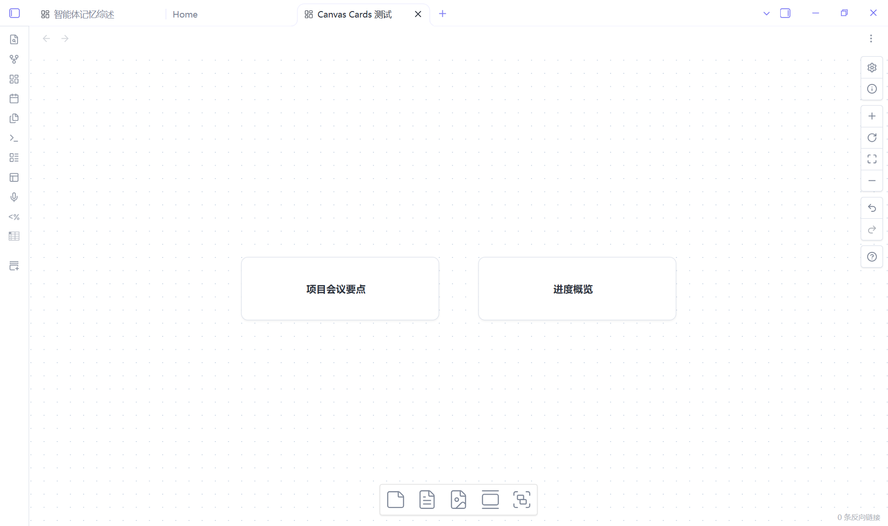
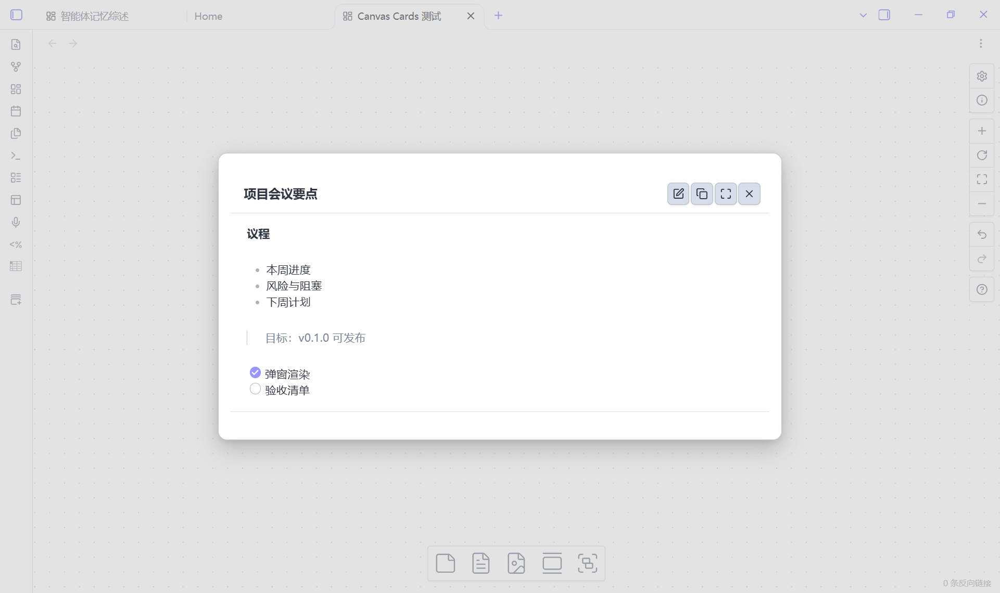
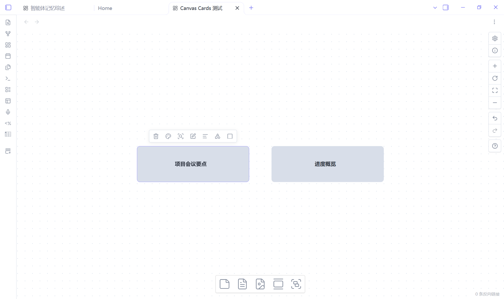
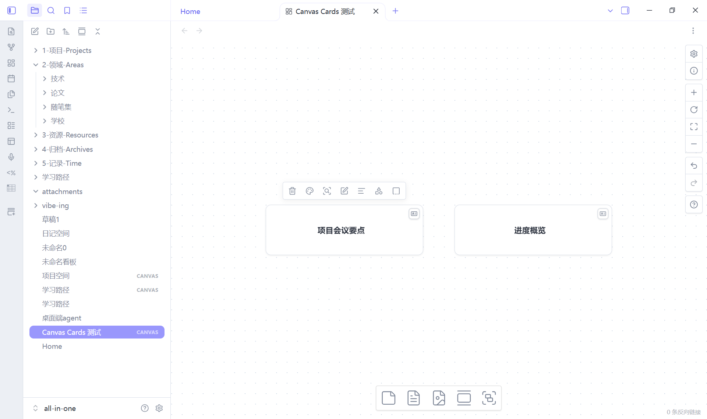
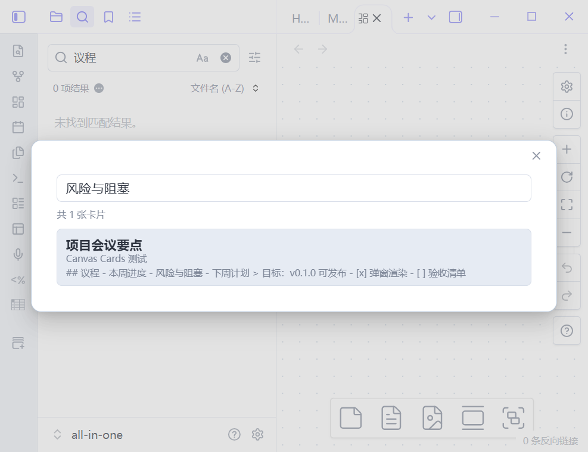
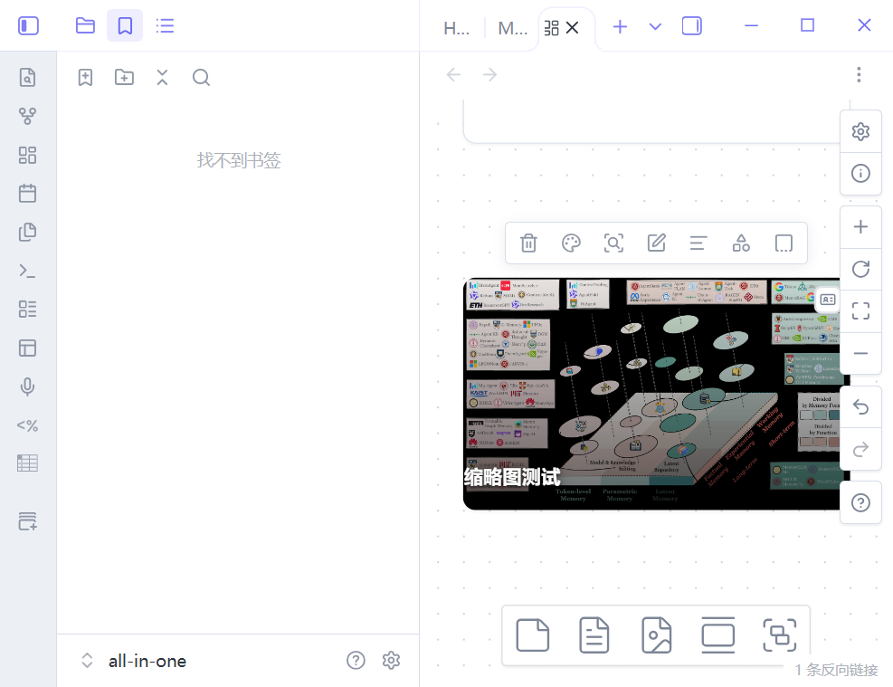

# Canvas Cards

Repository: [knink-owo/obsidian-canvas-cards](https://github.com/knink-owo/obsidian-canvas-cards)

Turn any Canvas text node into a **card**: the canvas only shows a clickable title
(optionally button-styled), and clicking the title opens a popup with the full,
rendered Markdown body. The body stays hidden inside the `.canvas` file until you
open it.





## Features

- **Card look on the canvas** — cards are native Canvas text nodes that render as a
  compact, centered title. One small corner button is the only injected element; the
  rest is a CSS class, so dragging, zooming, selecting and the Advanced Canvas
  features keep working.
- **Click to open** — a single click opens the card body in a centered popup; Shift,
  Ctrl/Cmd and middle-click are left to Canvas itself. The click also selects the
  node, so Delete and the native right-click menu still work. A corner button on each
  card opens it too, and the trigger can be set to *corner button only*.
- **Rendered Markdown body** — headings, lists, tables, callouts, task lists, links,
  `![[embeds]]` and images render through Obsidian's own Markdown renderer with the
  `.canvas` file as source path.
- **Lightweight editor** — toggle the popup into edit mode, edit the raw Markdown in
  a textarea, and the body autosaves (400 ms debounce, on blur and on close). Paste
  an image into the textarea and it is saved to the attachment folder with an
  `![[image]]` embed inserted. The popup also switches to full screen; `Esc` leaves
  full screen first, then closes.
- **Title editing** — the popup's title field renames the card (an explicit rename
  exists because a double-click no longer starts the native text editor, see
  [Behaviour details](#behaviour-details)).
- **Commands and context menu** — create, convert selected text nodes, cancel a
  card, edit a body, copy a body and export a card, from the command palette or the
  node context menu. Works next to Advanced Canvas menu items.
- **Add a card from the canvas menu** — right-click empty canvas space and pick
  **Add card** (appended to the native create menu) to create an empty card with its
  top-left corner at the pointer and start editing its body.
- **Bilingual UI** — English and Chinese follow Obsidian's language.
- **Graceful degradation** — the body lives in a normal node field
  (`canvasCard`), so a card opened in a vault without the plugin is just a text
  node whose title is the text; nothing is lost or corrupted.
- **Two appearances** — minimal (card) or button (`appearance` setting), and cards
  keep an explicit Canvas node color.
- **Search card bodies** — the **Search card bodies** command opens a search popup
  that indexes every card's title *and* hidden Markdown body across all canvases.
  Pick a result and the canvas opens, the card gets selected and its popup opens.
  (Obsidian's own global search still only sees Canvas node titles.)
- **Export a card to a note** — export the selected card as a Markdown note next to
  the canvas, with frontmatter recording the source canvas, node id and export time.
- **Cover thumbnail** — the first image embed anywhere in the body (`![[img.png]]`
  or ``) becomes the card cover with a dark gradient behind the
  title. Disable with the **Show thumbnails** setting.









## Installation

### From the community store

1. Open *Settings → Community plugins → Browse*.
2. Search for **Canvas Cards**, install it and enable it.

### Manually

1. Download `main.js`, `manifest.json` and `styles.css` from the
   [latest release](https://github.com/knink-owo/obsidian-canvas-cards/releases/latest).
2. Create `<your-vault>/.obsidian/plugins/canvas-cards/` and put the three files
   there.
3. Reload Obsidian and enable **Canvas Cards** in *Settings → Community plugins*.

Requires Obsidian **1.14.4+** (desktop). Mobile is not supported (the plugin is
`isDesktopOnly`). To uninstall, disable the plugin and delete its folder; card data
stays inside the `.canvas` files and is never deleted by the plugin.

## Usage

| Action | How |
| --- | --- |
| Create a card in the viewport center | Command **Create card** |
| Create a card where you right-clicked | Right-click empty canvas space → *Add card* |
| Convert selected text nodes to cards | Command **Convert selection to cards**, or node context menu → *Convert to card* |
| Open a card body | Click the card title or its corner button (or command **Edit card body**, or context menu → *Edit card*) |
| Rename a card | Open the popup and edit the title field |
| Remove a card (body kept, hidden) | Command **Remove card from selection**, or context menu → *Remove card* |
| Copy a card body | Command **Copy card body**, or context menu → *Copy body* |
| Search all card bodies | Command **Search card bodies** (works from any view) |
| Export a card to a note | Command **Export card to note** (needs a selected card), or context menu → *Export to note* |

Settings (*Settings → Canvas Cards*):

- **Card appearance** — `minimal` (default card look) or `button`.
- **Opening** — `click` (default: click the card) or `icon` (only the corner button
  opens the popup; the card keeps Canvas' native click behaviour).
- **Show thumbnails** — use the first image embed in the body as the card cover.
- **Show save status** — show/hide the small status line in the popup.

## Behaviour details

- **Click vs drag** — a press that moves more than 5 px is treated as a drag, not a
  click, so moving a card never opens the popup.
- **Corner button** — fades in when a card is hovered or focused, stays visible in
  the `icon` trigger mode, and is hidden while the native text editor is open. It
  opens the popup without starting a canvas drag.
- **Double-click no longer edits the title** on a card; use the popup title field.
  Edits to the body are made in the editor inside the popup.
- **Undo** — body autosaves are written without pushing every keystroke into the
  Canvas undo stack, but closing the popup pushes one history snapshot for the
  editing session. So one `Ctrl+Z` steps back over that body edit, and undoing
  earlier movement/creation actions cannot silently drop a body that was saved
  before them. Text edits inside the textarea use the browser's own undo.
- **Loading/rebuilds** — cards are re-detected after `rebuildView`, tab changes,
  zooming and plugin reloads; card data and the card look are restored from the
  `.canvas` file.

## How the data is stored

A card is an ordinary `text` node plus one namespaced field:

```json
{
  "id": "10b05ce72fddabb9",
  "type": "text",
  "text": "Card title",
  "x": 200,
  "y": 240,
  "width": 300,
  "height": 96,
  "canvasCard": {
    "v": 1,
    "card": true,
    "body": "## Markdown body\n\n- item",
    "updated": 1792405295679
  }
}
```

`text` is the title (rendered natively by Canvas), `canvasCard.body` is the hidden
Markdown body. Unknown node fields survive Canvas save/reload round-trips; cancelling
a card only flips `card` to `false` and keeps `body`. Advanced Canvas' own fields
(`styleAttributes`, `toFloating`, …) are untouched.

## Compatibility

- Tested with Obsidian **1.14.4** on Windows and with **Advanced Canvas 7.1.0**
  enabled (cards, dragging, context menus and Advanced Canvas features coexist).
- Obsidian Publish has no Canvas support, so published sites cannot show cards.

## Limitations

- Desktop only; the plugin is marked `isDesktopOnly`.
- The body text is not part of Canvas' own index, so Obsidian's global search and
  graph do not see it; use **Search card bodies** or **Export card to note** instead.
- The body editor is a plain textarea, not CodeMirror: no live preview, autocomplete
  or in-editor image preview.
- Cards cannot be moved between vaults without the plugin to re-attach the look;
  the data itself travels with the `.canvas` file.
- The plugin uses a small, documented set of Canvas internals (not public API); see
  `AGENTS.md` for the allowlist and constraints. The only prototype patch is the
  saved-original wrap of the canvas creation menu used by **Add card**; it is
  idempotent and restored when the plugin unloads, so disabling the plugin returns
  the native menu.

## Support

Report bugs and feature requests in the
[issue tracker](https://github.com/knink-owo/obsidian-canvas-cards/issues).
Please include the Obsidian version, the plugin version and, when possible, a minimal
`.canvas` file that shows the problem.

## Development

```bash
pnpm install
pnpm run dev      # watch build to main.js
pnpm run build    # type-check + production bundle
pnpm run lint
```

Copy `main.js`, `manifest.json` and `styles.css` into
`<vault>/.obsidian/plugins/canvas-cards/` and reload the plugin to test. UI and
interaction changes must be verified in a running Obsidian instance.

## Releasing

1. Bump the version (`pnpm version patch`, or update `manifest.json`, `package.json`
   and `versions.json` by hand) and commit all three version files together.
2. Push a tag equal to the `manifest.json` version (no `v` prefix). `pnpm version`
   creates a `v`-prefixed tag by default, so either tag by hand
   (`git tag 0.3.0 && git push origin 0.3.0`) or delete the wrong tag before
   pushing. A tag that does not match the manifest version fails the release job.
3. The `.github/workflows/release.yml` workflow builds, lints, checks the tag, and
   publishes the release; verify the artifacts instead of trusting the Actions tab,
   which can lag or show a stale *queued* run:

   ```bash
   gh release download <version> -D /tmp/release-check
   sha256sum main.js /tmp/release-check/main.js
   ```

4. Confirm `manifest.json` inside the release matches the repository one. Never edit
   `versions.json` history: it is append-only, one entry per published version.

## Publishing to the community directory

Submissions no longer go through a pull request to `obsidianmd/obsidian-releases`:
`community-plugins.json` there is a mirror regenerated hourly from
[community.obsidian.md](https://community.obsidian.md), so a manual PR would be
overwritten. The official flow is the directory website:

1. Sign in at <https://community.obsidian.md> with an Obsidian account.
2. Link the GitHub account that owns this repository; that is how ownership is
   verified.
3. Choose **Add plugin**, point it at `https://github.com/knink-owo/obsidian-canvas-cards`
   and confirm the description.
4. The directory reviews the `manifest.json` at the HEAD of the default branch
   automatically. Fix whatever it reports, bump the version, publish a new GitHub
   release — the directory picks the newest release up on its own. No further
   submissions are needed after the first one.

Before submitting, the repository must have `manifest.json`, `README.md` and
`LICENSE` at its root, a release whose tag equals the manifest version with
`main.js` / `manifest.json` / `styles.css` attached, a truthful `minAppVersion`, no
`fundingUrl` unless donations are accepted, and description punctuation/length
within the limits. The automated review enforces the
[submission requirements](https://docs.obsidian.md/community-directory/submission-requirements-for-plugins)
and the [developer policies](https://docs.obsidian.md/Developer+policies); the full
walkthrough is [Submit your plugin](https://docs.obsidian.md/plugins/releasing/submit-plugin).

## Documentation

- `docs/DESIGN.md` — decisions, data model, interaction spec, milestones.
- `docs/research/m0-runtime-notes.md` — runtime probes of Canvas internals.
- `docs/VERIFICATION.md` — acceptance evidence for v0.3.0 (v1.0 acceptance, v1.1 features, v0.2.0 review fixes and the v0.3.0 canvas-menu addition).

## License

0BSD — see `LICENSE`.
